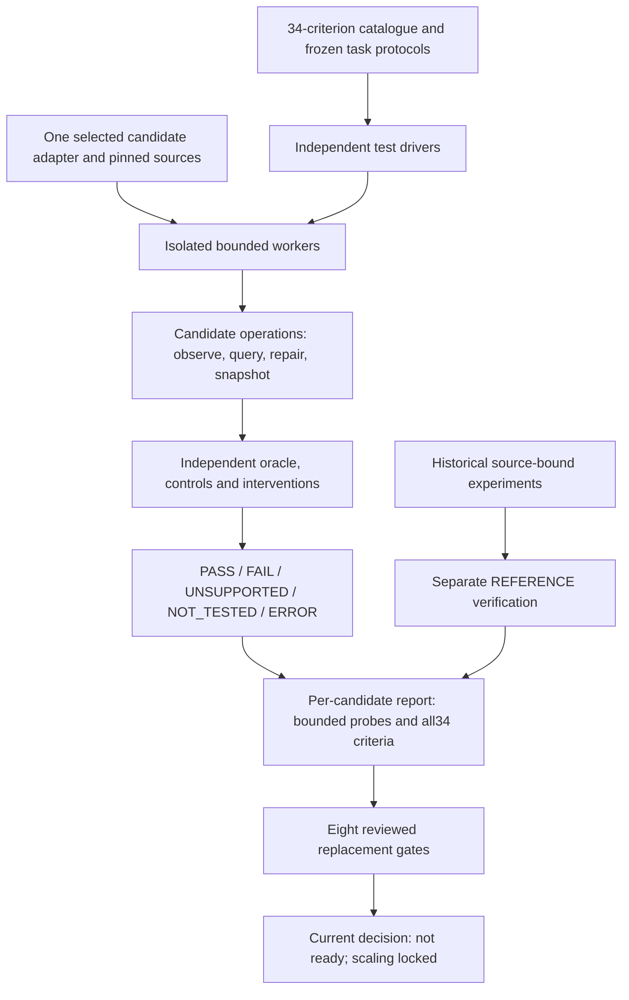
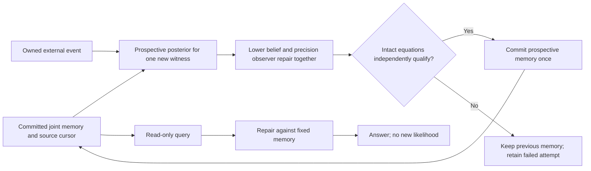

# Candidate, task, oracle and evidence

A candidate is one versioned implementation of owned state, typed boundary
ports, a repair rule, event admission and continuation. It is not an arbitrary
collection of successful models selected differently for each task. The suite
loads the same adapter and source revision for every task attributed to that
candidate. Fresh instances isolate independent tests; a memory task retains
one instance across its whole stream.

## Two clocks and two kinds of state

An external event is not a numerical iteration. A sensor witness may change
the interpretation and retained model; additional repair iterations must not
reinsert that witness as new independent evidence. A query can revisit the
same retained state without making the agent more confident merely because
it asked twice.

The retained-observer control uses three explicit phases:

This diagram also exposes that control's limitation: its exact posterior
compiler and variational readout are distinct executed operations. Sharing
one probabilistic interpretation is not the stronger one-rule architecture
the program is seeking.

## The observer must belong to the solve

The intended observer reads the current lower belief, including uncertainty,
and feeds back while lower and upper states remain revisable. Qualification
checks all participating equations. Reading a final diagnostic and then
running a separate controller does not satisfy this contract. A deepest
observer has no built-in right to overrule the other patches; its influence
must follow the same coupled constraints and learned or inherited relations.

The current Gaussian/Gamma readback experiments demonstrate this mechanism
in supplied low-dimensional models. They do not establish an advantage of
depth or that a biological brain implements their probability distributions.

## Structural fixtures

The factor interface accepts complete binary tables and specified cluster
edges. Candidate results are compared with independent enumeration. Exact
cluster-tree inference is only certified on its stated running-intersection
domain. Grouping a contradictory triangle into a three-variable bag is
explicitly charged; it is not a proof that unmodified loopy message passing
is exact.

The fly transition fixture contains four actual imported cell identities and
six directed influences. The adapter supplies binary current/next potential
variables, normalized local transitions and a complete joint current boundary.
The largest local table has32 entries. Reconstructing the next full boundary
can require256 assignments; it is not a free constant-size federation readout.
No motor identity or retinal input is invented for this olfactory motif.

The federation fixture distinguishes an exact shared pair distribution from
two independent marginal probabilities. Losing their correlation changes
downstream answers even when the individual marginals look identical.

## Execution and custody

The controller invokes workers with argument lists and no shell. It bounds
concurrency, elapsed time and combined output, kills a timed-out process group,
and retains errors in the report. Hashes before and after execution detect
candidate/harness/fixture drift. Imported fly receipts additionally validate
their transitive source pins. Timing samples are reported but excluded from
byte-stable replay comparison; answers and verdicts remain compared.

This is a local development tool, not a hostile-code sandbox. A user-selected
adapter is executable Python. Source review is part of the candidate audit;
the metadata list cannot discover hidden undeclared dependencies by itself.

An executable test establishes a bounded result. A mathematical theorem needs
its assumptions and proof artifact; a learned-capability claim needs held-out
tasks and controls; a utility claim needs matched information and total cost.
The report must not turn one type of evidence into another. All34 broad
criteria and eight production/replacement gates remain visible even when no
current task can discharge them.
